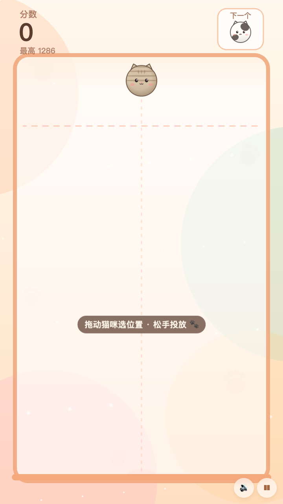
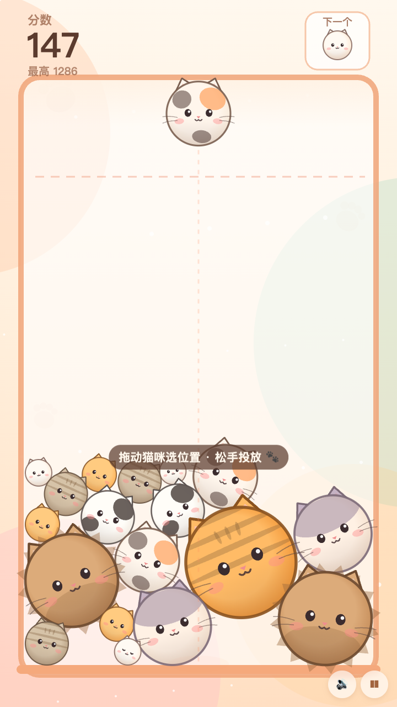
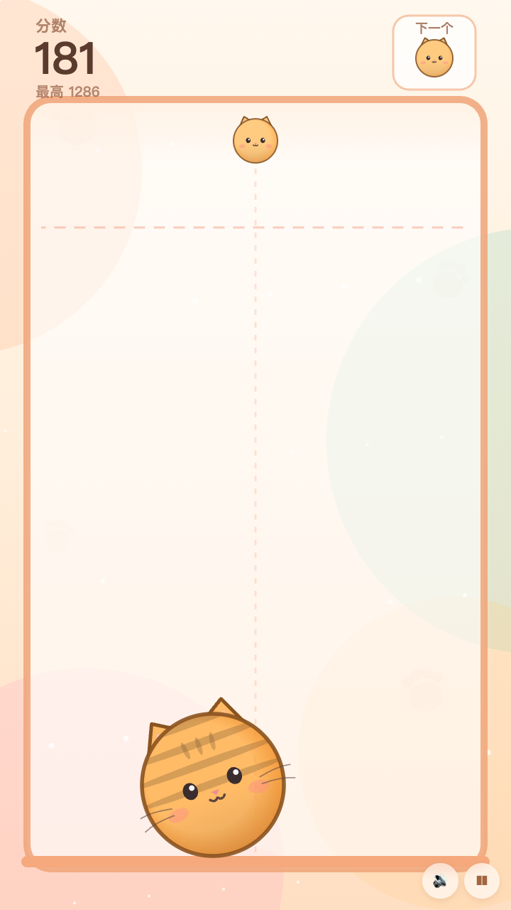
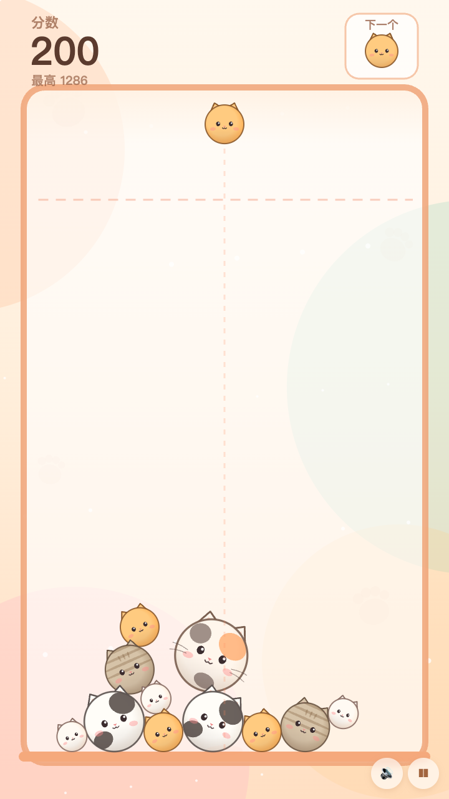
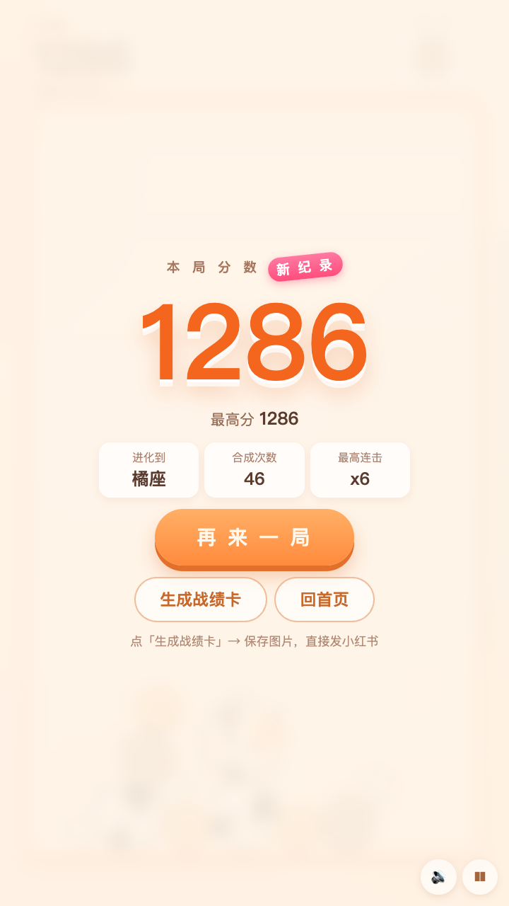
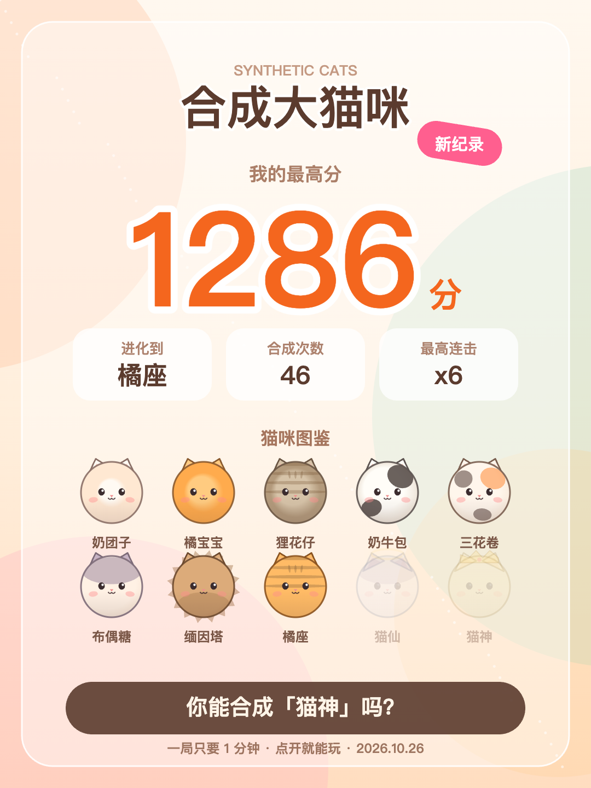
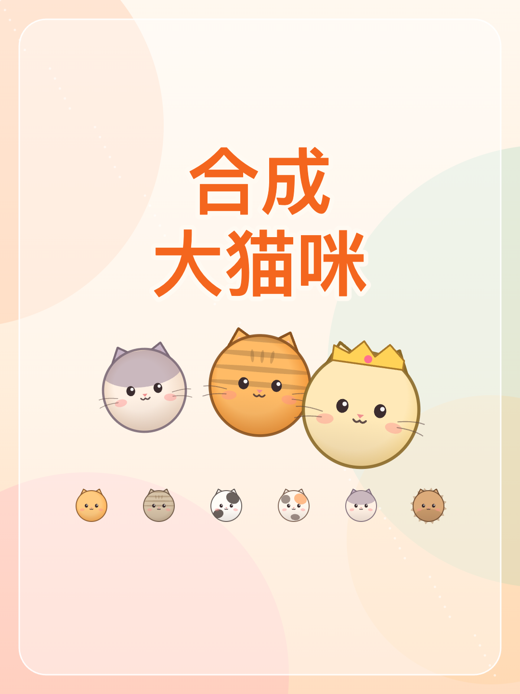

# 合成大猫咪 · 一局 1 分钟的猫咪合成小游戏

**竖屏手机 H5 小游戏，为小红书而生**：打开链接就能玩，全矢量手绘猫咪、实时合成音效、结束后一键生成 3:4「战绩卡」直接发笔记。

- 玩法：拖动决定落点 → 松手把猫丢进罐子 → **两只一样的猫碰到一起，合成下一级** → 10 级进化到「猫神」。
- 一局 1~2 分钟，有最高分、连锁加分、危险线倒计时，输赢都很快，适合反复刷。
- 纯前端、零依赖、零安装：所有画面是 Canvas 2D 实时绘制的矢量猫，所有声音是 WebAudio 现场合成，**没有一张图片、没有一个音频文件**，不联网也能玩。


---

## 开始游戏

- **本地玩**：双击 `index.html`（或双击 `启动游戏.command`），Chrome / Edge / Safari 打开即可。
- **本地服务器（推荐手机同 Wi-Fi 试玩）**：
  ```bash
  node server.mjs --host 0.0.0.0   # 终端会打印手机可访问的局域网地址
  ```
  默认端口 5182，本机访问 <http://127.0.0.1:5182>。
- **手机上玩**：见下方「发到小红书」——部署到任意 HTTPS 静态托管，手机浏览器打开即可。

## 玩法

1. 屏幕上方会出现一只猫，**按住左右拖动**选择落点，**松手**投进罐子。
2. 两只**同款猫**相撞 → 合成下一级，越大越难合成。
3. 连续合成有**连锁加成**（0.85 秒内接上就是连击，分数按 1 + 0.25×(连击-1) 倍放大）。
4. 猫堆超过虚线（警戒线）并**停留 1.7 秒**就结束；线会变红、有滴答警告，还有 `危险！1.2s` 倒计时。
5. 结束后可以「生成战绩卡」：1080×1440 的 3:4 图片，含分数、进化到哪只猫、连击、图鉴，可直接发小红书。







## 猫咪图鉴

| 级 | 猫 | 半径 | 合成得分 |
|---|---|---|---|
| 0 | 奶团子 | 24 | +1 |
| 1 | 橘宝宝 | 31 | +3 |
| 2 | 狸花仔 | 39 | +6 |
| 3 | 奶牛包 | 48 | +10 |
| 4 | 三花卷 | 58 | +16 |
| 5 | 布偶糖 | 70 | +24 |
| 6 | 缅因塔 | 84 | +34 |
| 7 | 橘座 | 100 | +46 |
| 8 | 猫仙 | 120 | +60 |
| 9 | 猫神 | 145 | +78 |

（得分是「两只 L 级合成」的基分，连击会再加成。）

## 操作

| 操作 | 触屏 | 键鼠 |
|---|---|---|
| 选落点 | 按住拖动 | 鼠标拖动 / `←` `→` |
| 投猫 | 松手 | 松开鼠标 / `空格` |
| 暂停继续 | 右下角 ❚❚ | `P` / `Esc` |
| 静音 | 右下角 🔊 | `M` |

## 发到小红书

> 调研结论（2025-2026，依据小红书开放平台官方文档）：**个人创作者目前无法在小红书上架自研小游戏**。小游戏入口在小红书小程序开放平台，仅支持境内企业主体、需 ICP 备案，且小游戏是「开白使用，需联系运营接入」，还要版号/软著等资质。所以个人号现实可行的路径是：**录屏笔记 + 站外 H5，靠评论区/主页承接流量**。

本游戏就是按这个路径设计的：

1. **录屏**：竖屏手机全屏录制（游戏会自动铺满 iPhone 屏幕，不留黑边），15~40 秒，剪开头 3 秒直接给「两只猫合体」的高光。
2. **首图**：用 `shots/xhs-cover.png`（1080×1440，已生成，可直接加字）。
3. **战绩卡**：玩完点「生成战绩卡」→ 保存，图里自带分数和图鉴，评论区晒分很好用。
4. **文案**：标题、正文、话题、置顶评论、审核避雷都写在 [`../推文/小红书_合成大猫咪_发布包.md`](../推文/小红书_合成大猫咪_发布包.md)。




部署到 HTTPS 静态托管（GitHub Pages / Vercel / 任意对象存储静态站）后，手机浏览器打开链接即可；GitHub Pages 放好本目录并保留 `.nojekyll` 就能跑，无需构建。

## 部署到 GitHub Pages

本目录已经是一个独立的 git 仓库（分支 `main`，含初始提交），推送后即可上线：

```bash
gh auth login        # 本机 GitHub CLI 只需登录一次
./deploy.sh          # 建仓库 CyanCat22/suika-cat → 推送 → 开启 Pages → 探测上线
```

- 手动方式：GitHub 新建空仓库 → `git remote add origin git@github.com:<你>/suika-cat.git` → `git push -u origin main` → Settings → Pages → Source 选 `main` / `/ (root)`（根目录已有 `.nojekyll`，无需 Actions）。
- 上线地址形如 `https://<你>.github.io/suika-cat/`，手机浏览器直接打开即可玩；也可以 README 顶部换成在线试玩链接。
- 想换仓库名/账号：`OWNER=xxx REPO=yyy ./deploy.sh`。

## 技术说明

- **渲染**：Canvas 2D，逻辑坐标系 720×(≥1280)；比 9:16 更瘦长的手机屏会按宽度铺满并把世界纵向拉长，iPhone 上**满屏无黑边**；宽屏则 9:16 居中。
- **物理**：自研圆形刚体（`js/physics.js`）：1/120s 子步长、每步 4 次迭代、位置修正 + 冲量 + 切向摩擦，堆叠稳定、不抖不穿墙。
- **美术**：`js/art.js` 用径向渐变、耳朵/眼睛/腮红/花纹/鬃毛/光环/皇冠等图元拼出 10 只猫，按等级换配色与花纹，零图片资源。
- **音效**：`js/audio.js` 用 WebAudio 合成，合成音高随等级升高；静音状态记忆在 localStorage。
- **战绩卡**：`js/sharecard.js` 在离屏 Canvas 上按 1080×1440 排版，不走后端。
- **接口**：`window.SUIKA`（`start` / `dropAt` / `game` / `state` 等）供自动化测试使用，详见 `docs/CONTRACT.md`。

## 目录

```
index.html          # 单页入口
style.css           # 竖屏 UI（菜单/结算/暂停/分享图弹层）
js/config.js        # 数值与 10 级猫咪配置（调参从这改）
js/physics.js       # 圆形物理
js/art.js           # 矢量猫绘制
js/audio.js         # WebAudio 音效
js/game.js          # 玩法状态机 + 渲染主循环
js/sharecard.js     # 战绩卡 / 封面图生成
js/main.js          # 输入、缩放、界面切换
server.mjs          # 本地静态服务器
tests/              # puppeteer 自动化验收与截图
shots/              # 截图与小红书图片
```

## 测试

需要 Node 18+ 与 `puppeteer-core`（`npm install`，或把 `PUPPETEER_PATH` 指向已有的 puppeteer-core 目录）：

```bash
npm run check     # 语法检查
npm test          # 35 项功能/物理/渲染/像素/适配验收
npm run shots     # 重新生成 shots/ 里的竖屏截图 + 小红书图片
npm run devices   # 390×844 / 820×1180 / 1440×900 三种屏幕的布局截图
```

验收记录见 [`QA-REPORT.md`](QA-REPORT.md)，自动化检查明细见 `tests/qa-func.mjs`。

## 已知限制

- 没有做真实机型的手感调试（自动化只能验证逻辑、物理与像素，手感要上手）。
- 音效在 headless 环境中只验证了「不抛异常」，听感需要真机试听。
- 没有后端：最高分只存在本机 localStorage，没有排行榜。
